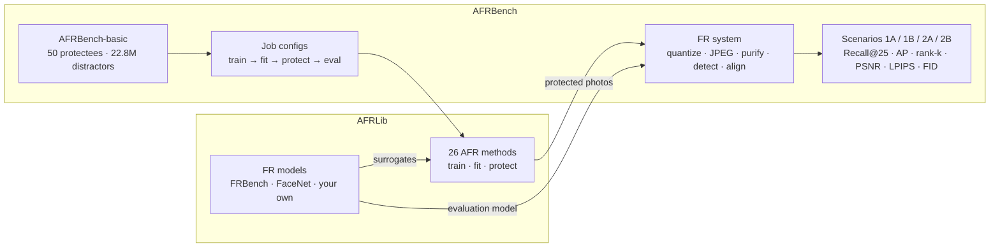

<div align="center">

# AFRBench

**A library and a benchmark for anti-facial-recognition methods**

[](LICENSE)
[](pyproject.toml)
[](#methods)
[](https://github.com/HKU-TASR/FRBench)

</div>

Anti-facial-recognition (AFR) methods modify a person's photos so that face-recognition search engines no longer find them while human observers can still recognize the person. **AFRLib** implements 26 published AFR methods behind one interface and decouples them from the face-recognition (FR) models they attack, so any method can be run against any FR model. **AFRBench** evaluates them under one protocol: the same people, photos, attack models, intruder pipelines, and metrics.

<p align="center">
  
  <br><em>Preview: interactive analysis of the AFRBench study (protection vs. visual quality). The viewer will be released in a future version.</em>
</p>

## Highlights

- **26 methods, one interface.** Personalized perturbation, per-sample perturbations, makeup, accessory, and face synthesis (GAN and diffusion) methods from 2016 to 2026, for dodging and impersonation. Every method takes original photos and returns protected photos of the same size, and declares what its train, fit, and protect stages need.
- **Any method against any FR model.** Attack surrogates are injected, so methods can be compared on the same models: the 45+ models of [FRBench](https://github.com/HKU-TASR/FRBench), our companion face-recognition benchmark, FaceNet, or your own.
- **A controlled protocol.** 50 protectees with 100 photos each and fixed album/query/gallery roles, 22.8M distractor faces, four threat scenarios, intruder pipelines with JPEG, resizing, and restoration defenses, and retrieval, identification, and visual-quality metrics.
- **Reproducible runs.** Every step is one YAML job with a lock file that records its inputs and code; runs resume after interruption and re-run only what changed.
- **Extensible.** Evaluate your own method or FR model by giving its import path; no change to the library is needed.

## Overview



| Scenario | Query | Gallery | Question |
|---|---|---|---|
| 1A | clean | protected | Is a person still found when their uploaded photos are protected? |
| 1B | clean | clean | Baseline without protection |
| 2A | protected | protected | Can a protected photo find other protected photos? |
| 2B | protected | clean | Can a protected photo find older, unprotected photos? |

## Methods

| Method | Venue | Goal | Stages | Paper | Code |
|---|---|---|---|---|---|
| Protego | CVPR 2026 | dodging | fit, protect | [paper](https://openaccess.thecvf.com/content/CVPR2026/papers/Wang_Protego_User-Centric_Pose-Invariant_Privacy_Protection_Against_Face_Recognition-Induced_Digital_Footprint_CVPR_2026_paper.pdf) | [code](https://github.com/HKU-TASR/Protego) |
| DivTrackee | CCS 2025 | dodging | protect | [paper](https://dl.acm.org/doi/epdf/10.1145/3719027.3744867) | [code](https://github.com/fiora6/divtrackee) |
| FPP-WDP | CVPR 2025 | impersonation | protect | [paper](https://openaccess.thecvf.com/content/CVPR2025/papers/Salar_Enhancing_Facial_Privacy_Protection_via_Weakening_Diffusion_Purification_CVPR_2025_paper.pdf) | [code](https://github.com/parham1998/Facial-Privacy-Protection) |
| DPA † | CVPR 2025 | impersonation | train, protect | [paper](https://openaccess.thecvf.com/content/CVPR2025/papers/Zhou_Improving_the_Transferability_of_Adversarial_Attacks_on_Face_Recognition_with_CVPR_2025_paper.pdf) | [code](https://github.com/fengfanzhou/DPA) |
| DiffAIM | ACM MM 2025 | impersonation | protect | [paper](https://dl.acm.org/doi/abs/10.1145/3746027.3755478) | [code](https://github.com/Liqin-Wang/DiffAIM) |
| AIDPro | TIFS 2025 | dodging | train, protect | [paper](https://ieeexplore.ieee.org/abstract/document/10884889/) | [code](https://github.com/daizigege/AIDPro) |
| DADP | TIFS 2025 | impersonation | protect | [paper](https://ieeexplore.ieee.org/abstract/document/11153602/) | [code](https://github.com/LiYuanBoJNU/DADP) |
| Adv-Inversion | TIFS 2025 | impersonation | protect | [paper](https://ieeexplore.ieee.org/abstract/document/11218144/) | [code](https://github.com/BiiiGerrr/Adv-Inversion) |
| AdvCloak | Pattern Recognition 2025 | dodging | train, fit, protect | [paper](https://www.sciencedirect.com/science/article/abs/pii/S003132032400801X) | [code](https://github.com/liuxuannan/AdvCloak) |
| DiffAM | CVPR 2024 | impersonation | train, protect | [paper](https://openaccess.thecvf.com/content/CVPR2024/html/Sun_DiffAM_Diffusion-based_Adversarial_Makeup_Transfer_for_Facial_Privacy_Protection_CVPR_2024_paper.html) | [code](https://github.com/HansSunY/DiffAM) |
| Chameleon | ECCV 2024 | dodging | fit, protect | [paper](https://www.ecva.net/papers/eccv_2024/papers_ECCV/papers/10846.pdf) | [code](https://github.com/git-disl/Chameleon) |
| Adv-Diffusion | AAAI 2024 | impersonation | protect | [paper](https://ojs.aaai.org/index.php/AAAI/article/view/28147) | [code](https://github.com/kopperx/Adv-Diffusion) |
| GIFT | ACM MM 2024 | impersonation | protect | [paper](https://dl.acm.org/doi/abs/10.1145/3664647.3681344) | – |
| CLIP2Protect | CVPR 2023 | impersonation | protect | [paper](https://openaccess.thecvf.com/content/CVPR2023/html/Shamshad_CLIP2Protect_Protecting_Facial_Privacy_Using_Text-Guided_Makeup_via_Adversarial_Latent_CVPR_2023_paper.html) | [code](https://github.com/fahadshamshad/Clip2Protect) |
| FALCO | CVPR 2023 | dodging | protect | [paper](https://openaccess.thecvf.com/content/CVPR2023/html/Barattin_Attribute-Preserving_Face_Dataset_Anonymization_via_Latent_Code_Optimization_CVPR_2023_paper.html) | [code](https://github.com/chi0tzp/FALCO) |
| AT3D | CVPR 2023 | impersonation | protect | [paper](https://openaccess.thecvf.com/content/CVPR2023/html/Yang_Towards_Effective_Adversarial_Textured_3D_Meshes_on_Physical_Face_Recognition_CVPR_2023_paper.html) | [code](https://github.com/thu-ml/AT3D) |
| AMT-GAN | CVPR 2022 | impersonation | train, protect | [paper](https://openaccess.thecvf.com/content/CVPR2022/html/Hu_Protecting_Facial_Privacy_Generating_Adversarial_Identity_Masks_via_Style-Robust_Makeup_CVPR_2022_paper.html) | [code](https://github.com/CGCL-codes/AMT-GAN) |
| OPOM | TPAMI 2022 | dodging | fit, protect | [paper](https://ieeexplore.ieee.org/abstract/document/9778974/) | [code](https://github.com/zhongyy/OPOM) |
| TIP-IM | ICCV 2021 | impersonation | protect | [paper](https://openaccess.thecvf.com/content/ICCV2021/papers/Yang_Towards_Face_Encryption_by_Generating_Adversarial_Identity_Masks_ICCV_2021_paper.pdf) | [code](https://github.com/ShawnXYang/TIP-IM) |
| LowKey | ICLR 2021 | dodging | protect | [paper](https://openreview.net/pdf?id=hJmtwocEqzc) | [code](https://openreview.net/forum?id=hJmtwocEqzc) |
| Adv-Makeup | IJCAI 2021 | impersonation | train, protect | [paper](https://www.ijcai.org/proceedings/2021/0173.pdf) | [code](https://github.com/TencentYoutuResearch/Adv-Makeup) |
| Fawkes | USENIX Security 2020 | dodging | protect | [paper](https://people.cs.uchicago.edu/~ravenben/publications/pdf/fawkes-usenix20.pdf) | [code](https://github.com/Shawn-Shan/fawkes) |
| APF | ACM MM 2020 | dodging | train, fit, protect | [paper](https://dl.acm.org/doi/10.1145/3394171.3413906) | [code](https://github.com/adversarial-for-goodness/APF) |
| AdvHat | ICPR 2020 | dodging | fit, protect | [paper](https://ieeexplore.ieee.org/document/9412236) | [code](https://github.com/papermsucode/advhat) |
| Efficient Decision-based † | CVPR 2019 | dodging | protect | [paper](https://openaccess.thecvf.com/content_CVPR_2019/papers/Dong_Efficient_Decision-Based_Black-Box_Adversarial_Attacks_on_Face_Recognition_CVPR_2019_paper.pdf) | [code](https://github.com/sgmath12/efficient-decision-based-black-box-adversarial-attacks-on-face-recognition) |
| Accessorize | CCS 2016 | dodging | fit, protect | [paper](https://dl.acm.org/doi/pdf/10.1145/2976749.2978392) | [code](https://github.com/mahmoods01/accessorize-to-a-crime) |

† Implemented in AFRLib but not part of the AFRBench-basic protocol. Per-stage inputs are
listed in [docs/methods.md](docs/methods.md).

## Installation

```bash
git clone https://github.com/HKU-TASR/AFRBench && cd AFRBench
bash setup.sh                  # conda env "afrbench" with CUDA; use --cpu for a CPU-only install
conda activate afrbench
```

`setup.sh` installs pinned dependencies (`requirements.txt`) and the package in editable
mode. Method weights are downloaded on first use to `~/.afrlib` (set `AFRLIB_HOME` to
change it). Protego's FLAME model has to be obtained by hand under its license; see
[docs/benchmark.md](docs/benchmark.md#1-install).

## Quick start

**Protect a photo with any method**, using AFRLib as a library:

```python
from PIL import Image
from torchvision.transforms.functional import pil_to_tensor

from afrlib import build_fr_ensemble
from afrlib.afr import Fawkes
from afrlib.contracts import EvalData

photo = pil_to_tensor(Image.open("me.jpg").convert("RGB")).float()   # [3, H, W] in [0, 255]
frs = build_fr_ensemble(
    [{"backend": "frbench", "backbone": "irse-100", "loss": "arcface", "dataset": "ms1m"}],
    device="cuda",
)
det = frs[0].detect([photo])
geometry = {"face_box": det.boxes[0][0].tolist(), "landmarks": det.landmarks[0][0].tolist()}
protected = Fawkes("cuda", frs).protect(EvalData(eval_imgs=[photo], eval_geometry=[geometry]))[0]
```

Methods that impersonate a target, fit to one person, or train first take their extra
inputs the same way; see [docs/library.md](docs/library.md).

**Benchmark a method** on AFRBench-basic, after obtaining the data
([docs/benchmark.md](docs/benchmark.md)):

```bash
python -m afrbench.millioncelebs download --out /big/mc
python -m afrbench.millioncelebs pack --src /big/mc --out /big/mc/noise.lmdb
python -m afrbench.prepare --getty ~/getty --noise /big/mc/noise.lmdb --out /big/afrbench/basic
python -m afrbench.benchmark --method fawkes --dataset /big/afrbench/basic --out results/fawkes
```

**Bring your own method or FR model** by import path:

```bash
python -m afrbench.benchmark --method my_pkg.cloak:MyCloak --dataset /big/afrbench/basic --out results/mine
python -m afrbench.benchmark --method fawkes --eval-fr my_pkg.fr:MyRecognizer --dataset /big/afrbench/basic --out results/fawkes
```

A minimal method to start from is in [examples/custom_method](examples/custom_method);
the interfaces are described in [docs/extending.md](docs/extending.md).

## Documentation

| Guide | Content |
|---|---|
| [docs/library.md](docs/library.md) | Using AFRLib: inputs, lifecycles, FR models, weights |
| [docs/benchmark.md](docs/benchmark.md) | Running AFRBench from a fresh machine to results |
| [docs/protocol.md](docs/protocol.md) | The AFRBench-basic protocol: data, scenarios, metrics, evaluation suite |
| [docs/data.md](docs/data.md) | What data the repository ships and what you obtain |
| [docs/methods.md](docs/methods.md) | Stages and inputs of every method |
| [docs/extending.md](docs/extending.md) | Adding an AFR method or an FR model |

## Roadmap

- Interactive viewer for benchmark results.
- Released checkpoints for the methods that train.
- Precomputed distractor embeddings for the default FR systems.
- Multi-GPU execution of the full method suite.
- Leaderboard and the AFRBench paper.

## Citation

AFRBench grows out of Protego. If you use it, please cite:

```bibtex
@inproceedings{wang2026protego,
    title={Protego: User-Centric Pose-Invariant Privacy Protection Against Face Recognition-Induced Digital Footprint Exposure},
    author={Ziling Wang and Shuya Yang and Jialin Lu and Ka-Ho Chow},
    booktitle={Proceedings of the IEEE/CVF Conference on Computer Vision and Pattern Recognition},
    year={2026}
}
```

## License

The code written for AFRLib and AFRBench is released under the [MIT license](LICENSE).
Methods and vendored components keep their original licenses, several of which allow
research use only; see [THIRD_PARTY.md](THIRD_PARTY.md). GIFT (`afrlib/afr/gift/`) is
licensed under the AGPL-3.0 because it incorporates BDInvert code. Downloaded models
and datasets are subject to their providers' terms.

AFR methods are published to help people protect their photos from unwanted
recognition. Please use this code for research on privacy protection and on the
robustness of face recognition.

## Acknowledgements

We thank the authors of every method and model included here for releasing their code.
FR models are provided by [FRBench](https://github.com/HKU-TASR/FRBench), our companion
benchmark that packages 45+ face-recognition models behind one interface.
