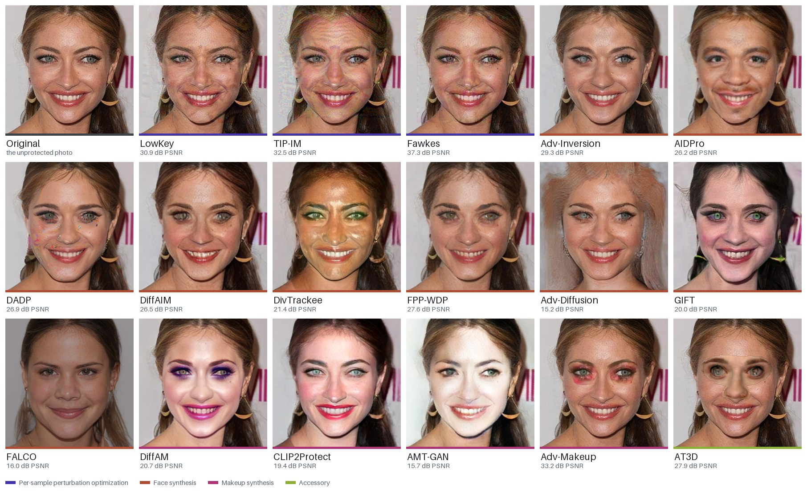
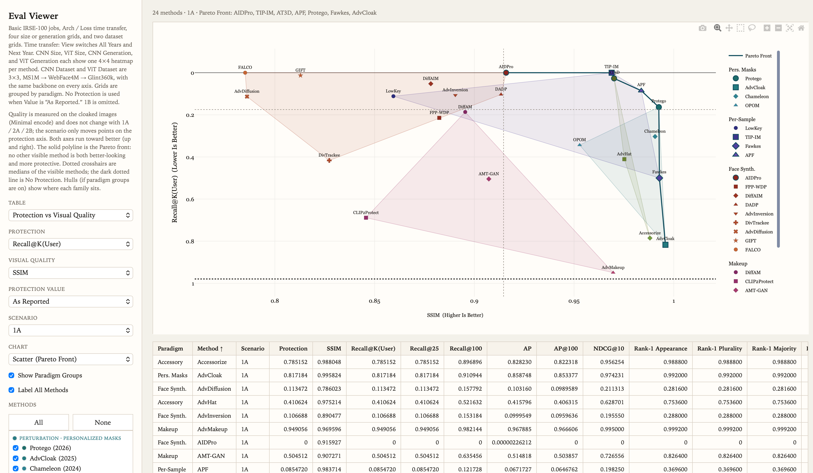
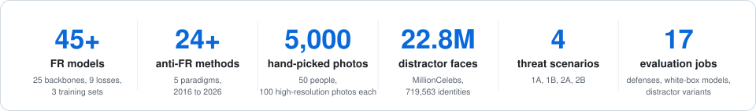
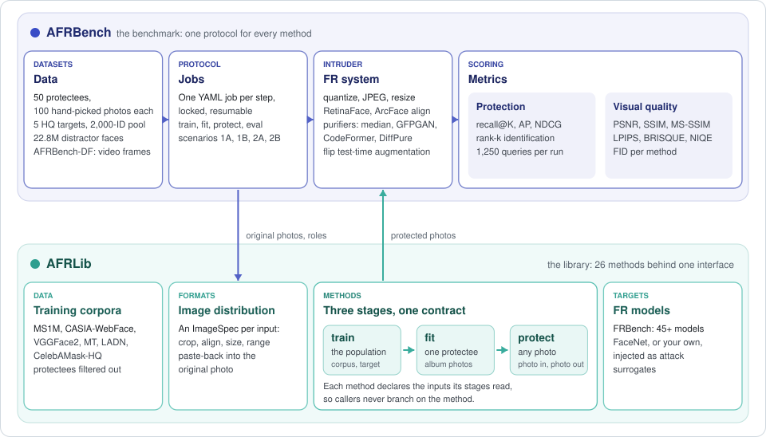
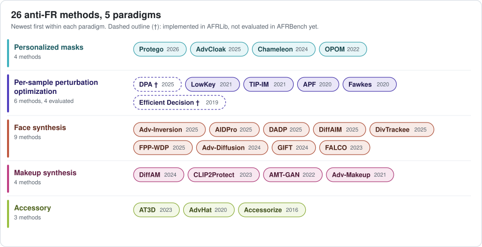
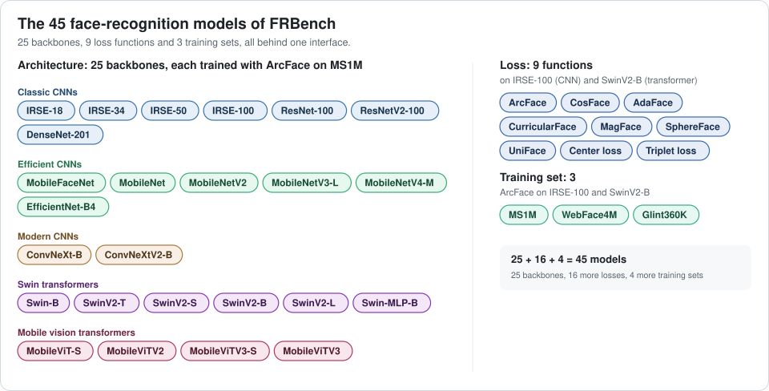

<div align="center">

# AFRBench

**A library and a benchmark for anti-facial-recognition methods**

[](LICENSE)
[](pyproject.toml)
[](#methods)
[](#fr-models)

[Overview](#overview) · [Methods](#methods) · [FR models](#fr-models) · [Installation](#installation) · [Quick start](#quick-start) · [Documentation](#documentation) · [Citation](#citation)

</div>

Anti-facial-recognition (AFR) methods change a person's photos so that face-recognition (FR) search engines no longer find them, while people can still recognize the face. Dozens have been published, each tested against its own models, data, and metrics, so their results rarely line up.

AFRBench puts them on common ground. **AFRLib** implements 26 published AFR methods behind one interface and separates them from the FR models they attack, so any method can be run against any model. **AFRBench** evaluates 24 of them so far under one protocol: the same people, photos, attack models, intruder pipelines, and metrics. It comes with 45+ FR models we trained, 5,000 hand-picked photos of 50 people, 22.8M distractor faces, and, in AFRBench-DF, video frames that vary in pose and expression.

<p align="center">
  
  <br><em>One photo, 17 methods. Each tile is a method's default output on a CelebA-HQ face that ships with the repository, with the PSNR of that photo. The seven methods that fit to an album of the person (Accessorize, AdvCloak, AdvHat, APF, Chameleon, OPOM, Protego) are not shown. <code>tools/readme_figures/make_showcase.py</code> regenerates it.</em>
</p>

<p align="center">
  
  <br><em>The AFRBench study in its viewer: protection against visual quality for every evaluated method. The viewer will be released in a future version.</em>
</p>

<p align="center">
  
</p>

## Highlights

- **26 methods, one interface.** Personalized masks, per-sample perturbation optimization, face and makeup synthesis (GAN and diffusion), and accessories, from 2016 to 2026, for dodging and for impersonation. Every method takes original photos and returns protected photos of the same size, and declares what its train, fit, and protect stages need. AFRBench evaluates 24 of them so far.
- **Any method against any FR model, and we trained 45+ of them.** Attack surrogates are injected, so methods can be compared on the same models: the 45+ FR models we trained across 25 backbones, from IRSE and MobileNets to Swin transformers, and 9 loss functions (packaged in [FRBench](https://github.com/HKU-TASR/FRBench), our companion face-recognition benchmark), FaceNet, or your own.
- **A controlled protocol.** 50 protectees with 100 carefully selected, hand-picked, high-resolution photos each, in fixed album, query, and gallery roles. 22.8M distractor faces, four threat scenarios, intruder pipelines with JPEG, resizing, and restoration defenses, and retrieval, identification, and visual-quality metrics.
- **Pose and expression.** AFRBench-DF applies the same protocol to frames of the DeeperForensics-1.0 source videos. Every frame is labeled with its camera and emotion, so protection can be reported for each viewpoint and expression.
- **Reproducible runs.** Every step is one YAML job with a lock file that records its inputs and code; runs resume after interruption and re-run only what changed.
- **Extensible.** Evaluate your own method or FR model by giving its import path; no change to the library is needed.

## Overview

<p align="center">
  
</p>

### AFRLib: one interface for every method

- **Training corpora.** Methods that train read their corpora (MS1M, CASIA-WebFace, VGGFace2, MT, LADN, CelebAMask-HQ) from one registry of packed LMDB files, with identity filters that keep the benchmark's protectees out. Pretrained priors are downloaded once and checked against a checksum.
- **Image distribution.** Every method works in its own image format: a crop around the face, an alignment, a size, a channel order, and a value range. A method declares that format as an `ImageSpec`; the library prepares each input in it and pastes the result back into the original photo. A method that edits a 256-pixel face crop and one that perturbs the whole photo take the same input and return the same output.
- **FR models.** Attack surrogates are plain arguments: `build_fr_ensemble` builds them from a short spec, and a method only ever sees the list it is given.

**Train, fit, protect.** A method has up to three stages. `train` runs once, on a corpus, for everyone. `fit` runs once per protectee, on an album of that person's photos. `protect` runs on any photo. A method implements the stages it needs and declares the inputs each one reads:

```python
class APF(AFRMethod):
    train_inputs = StageInputs(required=("corpus",))
    fit_inputs = StageInputs(required=("protectee_album",))
    eval_inputs = StageInputs(required=("eval_imgs",))
```

Those declarations are the whole contract. A caller assembles exactly the inputs a stage declares, a missing one is an error, and the benchmark works out how to run the method from them (`afrbench.protocol.method_roles`): whether it trains, fits, bakes a target into its weights, reads a target when it protects, or draws one from a pool. Neither the library nor the runner branches on a method's name, so the 26 methods run through one runner and a new one plugs in by import path. The protocol names a method in just two places: the two it holds back (DPA and EfficientDecision) and DivTrackee's larger target pool.

### AFRBench: one protocol for every method

- **Data.** AFRBench-basic has 50 protectees (25 actors and 25 actresses) with 100 photos each, in roles fixed in the dataset: 50 album, 25 query, and 25 gallery photos, and photos from the same day never share a role. The search gallery adds 22.8M distractor faces of 719,563 identities ([MillionCelebs](https://buptzyb.github.io/MillionCelebs/)). Five CelebA-HQ images and a pool of 2,000 identities serve the methods that impersonate someone.
- **FR system.** The intruder is an FR model plus its image pipeline: quantization, JPEG, resizing, RetinaFace detection, ArcFace alignment, an optional purifier (median filter, GFPGAN, CodeFormer, or DiffPure), and flip test-time augmentation. These are the benchmark's basic adaptive attacks. The 17-job evaluation suite runs quantization, JPEG, flip augmentation, and the median, GFPGAN, and CodeFormer purifiers in separate jobs, next to white-box and distractor-set variants.
- **Protection metrics.** recall@K (primary; lower means better protection), AP, NDCG, and rank-k identification, in four scenarios:

| Scenario | Query | Gallery | Question |
|---|---|---|---|
| 1A | clean | protected | Is a person still found when their uploaded photos are protected? |
| 1B | clean | clean | Baseline without protection |
| 2A | protected | protected | Can a protected photo find other protected photos? |
| 2B | protected | clean | Can a protected photo find older, unprotected photos? |

- **Visual quality.** PSNR, SSIM, MS-SSIM, LPIPS, BRISQUE, NIQE, and FID, comparing protected photos with the clean ones.
- **AFRBench-DF.** The same protocol on frames of the [DeeperForensics-1.0](https://github.com/EndlessSora/DeeperForensics-1.0) source videos: 100 actors recorded at 1080p with 7 cameras covering poses from -90 to +90 degrees and 8 emotions. Roles are disjoint by clip, and every frame keeps its camera and emotion as labels, so `python -m afrbench.groups --by camera` reports a method's protection per viewpoint or expression. The videos come from their authors and are not part of this repository.

## Methods

AFRLib implements 26 methods and AFRBench evaluates 24 of them so far. The chart groups them by paradigm, newest first; the two marked † are implemented but not yet evaluated.

<p align="center">
  
</p>

<details>
<summary>Venues, papers, and code</summary>

<!-- methods-table:start -->

**Personalized masks**

| Method | Venue | Paper | Code |
|---|---|---|---|
| Protego | CVPR 2026 | [paper](https://openaccess.thecvf.com/content/CVPR2026/papers/Wang_Protego_User-Centric_Pose-Invariant_Privacy_Protection_Against_Face_Recognition-Induced_Digital_Footprint_CVPR_2026_paper.pdf) | [code](https://github.com/HKU-TASR/Protego) |
| AdvCloak | Pattern Recognition 2025 | [paper](https://www.sciencedirect.com/science/article/abs/pii/S003132032400801X) | [code](https://github.com/liuxuannan/AdvCloak) |
| Chameleon | ECCV 2024 | [paper](https://www.ecva.net/papers/eccv_2024/papers_ECCV/papers/10846.pdf) | [code](https://github.com/git-disl/Chameleon) |
| OPOM | TPAMI 2022 | [paper](https://ieeexplore.ieee.org/abstract/document/9778974/) | [code](https://github.com/zhongyy/OPOM) |

**Per-sample perturbation optimization**

| Method | Venue | Paper | Code |
|---|---|---|---|
| DPA † | CVPR 2025 | [paper](https://openaccess.thecvf.com/content/CVPR2025/papers/Zhou_Improving_the_Transferability_of_Adversarial_Attacks_on_Face_Recognition_with_CVPR_2025_paper.pdf) | [code](https://github.com/fengfanzhou/DPA) |
| LowKey | ICLR 2021 | [paper](https://openreview.net/pdf?id=hJmtwocEqzc) | [code](https://openreview.net/forum?id=hJmtwocEqzc) |
| TIP-IM | ICCV 2021 | [paper](https://openaccess.thecvf.com/content/ICCV2021/papers/Yang_Towards_Face_Encryption_by_Generating_Adversarial_Identity_Masks_ICCV_2021_paper.pdf) | [code](https://github.com/ShawnXYang/TIP-IM) |
| APF | ACM MM 2020 | [paper](https://dl.acm.org/doi/10.1145/3394171.3413906) | [code](https://github.com/adversarial-for-goodness/APF) |
| Fawkes | USENIX Security 2020 | [paper](https://people.cs.uchicago.edu/~ravenben/publications/pdf/fawkes-usenix20.pdf) | [code](https://github.com/Shawn-Shan/fawkes) |
| Efficient Decision † | CVPR 2019 | [paper](https://openaccess.thecvf.com/content_CVPR_2019/papers/Dong_Efficient_Decision-Based_Black-Box_Adversarial_Attacks_on_Face_Recognition_CVPR_2019_paper.pdf) | [code](https://github.com/sgmath12/efficient-decision-based-black-box-adversarial-attacks-on-face-recognition) |

**Face synthesis**

| Method | Venue | Paper | Code |
|---|---|---|---|
| Adv-Inversion | TIFS 2025 | [paper](https://ieeexplore.ieee.org/abstract/document/11218144/) | [code](https://github.com/BiiiGerrr/Adv-Inversion) |
| AIDPro | TIFS 2025 | [paper](https://ieeexplore.ieee.org/abstract/document/10884889/) | [code](https://github.com/daizigege/AIDPro) |
| DADP | TIFS 2025 | [paper](https://ieeexplore.ieee.org/abstract/document/11153602/) | [code](https://github.com/LiYuanBoJNU/DADP) |
| DiffAIM | ACM MM 2025 | [paper](https://dl.acm.org/doi/abs/10.1145/3746027.3755478) | [code](https://github.com/Liqin-Wang/DiffAIM) |
| DivTrackee | CCS 2025 | [paper](https://dl.acm.org/doi/epdf/10.1145/3719027.3744867) | [code](https://github.com/fiora6/divtrackee) |
| FPP-WDP | CVPR 2025 | [paper](https://openaccess.thecvf.com/content/CVPR2025/papers/Salar_Enhancing_Facial_Privacy_Protection_via_Weakening_Diffusion_Purification_CVPR_2025_paper.pdf) | [code](https://github.com/parham1998/Facial-Privacy-Protection) |
| Adv-Diffusion | AAAI 2024 | [paper](https://ojs.aaai.org/index.php/AAAI/article/view/28147) | [code](https://github.com/kopperx/Adv-Diffusion) |
| GIFT | ACM MM 2024 | [paper](https://dl.acm.org/doi/abs/10.1145/3664647.3681344) | – |
| FALCO | CVPR 2023 | [paper](https://openaccess.thecvf.com/content/CVPR2023/html/Barattin_Attribute-Preserving_Face_Dataset_Anonymization_via_Latent_Code_Optimization_CVPR_2023_paper.html) | [code](https://github.com/chi0tzp/FALCO) |

**Makeup synthesis**

| Method | Venue | Paper | Code |
|---|---|---|---|
| DiffAM | CVPR 2024 | [paper](https://openaccess.thecvf.com/content/CVPR2024/html/Sun_DiffAM_Diffusion-based_Adversarial_Makeup_Transfer_for_Facial_Privacy_Protection_CVPR_2024_paper.html) | [code](https://github.com/HansSunY/DiffAM) |
| CLIP2Protect | CVPR 2023 | [paper](https://openaccess.thecvf.com/content/CVPR2023/html/Shamshad_CLIP2Protect_Protecting_Facial_Privacy_Using_Text-Guided_Makeup_via_Adversarial_Latent_CVPR_2023_paper.html) | [code](https://github.com/fahadshamshad/Clip2Protect) |
| AMT-GAN | CVPR 2022 | [paper](https://openaccess.thecvf.com/content/CVPR2022/html/Hu_Protecting_Facial_Privacy_Generating_Adversarial_Identity_Masks_via_Style-Robust_Makeup_CVPR_2022_paper.html) | [code](https://github.com/CGCL-codes/AMT-GAN) |
| Adv-Makeup | IJCAI 2021 | [paper](https://www.ijcai.org/proceedings/2021/0173.pdf) | [code](https://github.com/TencentYoutuResearch/Adv-Makeup) |

**Accessory**

| Method | Venue | Paper | Code |
|---|---|---|---|
| AT3D | CVPR 2023 | [paper](https://openaccess.thecvf.com/content/CVPR2023/html/Yang_Towards_Effective_Adversarial_Textured_3D_Meshes_on_Physical_Face_Recognition_CVPR_2023_paper.html) | [code](https://github.com/thu-ml/AT3D) |
| AdvHat | ICPR 2020 | [paper](https://ieeexplore.ieee.org/document/9412236) | [code](https://github.com/papermsucode/advhat) |
| Accessorize | CCS 2016 | [paper](https://dl.acm.org/doi/pdf/10.1145/2976749.2978392) | [code](https://github.com/mahmoods01/accessorize-to-a-crime) |

† Implemented in AFRLib but not part of the AFRBench-basic protocol. Per-stage inputs are listed in [docs/methods.md](docs/methods.md).

<!-- methods-table:end -->

</details>

## FR models

<p align="center">
  
</p>

The FR models are the 45 we have trained so far, and every one of them is a spec away: `{"backend": "frbench", "backbone": "swinv2-b", "loss": "arcface", "dataset": "glint360k"}`. Twenty-five backbones are trained with ArcFace on MS1M; IRSE-100 and SwinV2-B, a CNN and a transformer, carry all nine loss functions and all three training sets. [FRBench](https://github.com/HKU-TASR/FRBench) packages them behind one interface.

## Installation

```bash
git clone https://github.com/HKU-TASR/AFRBench && cd AFRBench
bash setup.sh                  # conda env "afrbench" with CUDA; use --cpu for a CPU-only install
conda activate afrbench
```

`setup.sh` installs pinned dependencies (`requirements.txt`) and the package in editable
mode. Method weights are downloaded on first use to `~/.afrlib` (set `AFRLIB_HOME` to
change it). Protego's FLAME model has to be obtained by hand under its license; see
[docs/benchmark.md](docs/benchmark.md#1-install).

## Quick start

**Protect a photo with any method**, using AFRLib as a library:

```python
from PIL import Image
from torchvision.transforms.functional import pil_to_tensor

from afrlib import build_fr_ensemble
from afrlib.afr import Fawkes
from afrlib.contracts import EvalData

photo = pil_to_tensor(Image.open("me.jpg").convert("RGB")).float()   # [3, H, W] in [0, 255]
frs = build_fr_ensemble(
    [{"backend": "frbench", "backbone": "irse-100", "loss": "arcface", "dataset": "ms1m"}],
    device="cuda",
)
det = frs[0].detect([photo])
geometry = {"face_box": det.boxes[0][0].tolist(), "landmarks": det.landmarks[0][0].tolist()}
protected = Fawkes("cuda", frs).protect(EvalData(eval_imgs=[photo], eval_geometry=[geometry]))[0]
```

Methods that impersonate a target, fit to one person, or train first take their extra
inputs the same way; see [docs/library.md](docs/library.md).

**Benchmark a method** on AFRBench-basic, after obtaining the data
([docs/benchmark.md](docs/benchmark.md)):

```bash
python -m afrbench.millioncelebs download --out /big/mc
python -m afrbench.millioncelebs pack --src /big/mc --out /big/mc/noise.lmdb
python -m afrbench.prepare --getty ~/getty --noise /big/mc/noise.lmdb --out /big/afrbench/basic
python -m afrbench.benchmark --method fawkes --dataset /big/afrbench/basic --out results/fawkes
```

**Or on AFRBench-DF**, from the DeeperForensics-1.0 source videos, and read the result per camera:

```bash
python -m afrbench.deeperforensics prepare --videos ~/df --noise /big/mc/noise.lmdb --out /big/afrbench/df
python -m afrbench.benchmark --method fawkes --dataset /big/afrbench/df --out results/fawkes_df
python -m afrbench.groups --dataset /big/afrbench/df --eval results/fawkes_df/eval/minimal --by camera
```

**Bring your own method or FR model** by import path:

```bash
python -m afrbench.benchmark --method my_pkg.cloak:MyCloak --dataset /big/afrbench/basic --out results/mine
python -m afrbench.benchmark --method fawkes --eval-fr my_pkg.fr:MyRecognizer --dataset /big/afrbench/basic --out results/fawkes
```

A minimal method to start from is in [examples/custom_method](examples/custom_method);
the interfaces are described in [docs/extending.md](docs/extending.md).

## Documentation

| Guide | Content |
|---|---|
| [docs/library.md](docs/library.md) | Using AFRLib: inputs, lifecycles, FR models, weights |
| [docs/benchmark.md](docs/benchmark.md) | Running AFRBench from a fresh machine to results |
| [docs/protocol.md](docs/protocol.md) | The AFRBench protocol: data, scenarios, metrics, evaluation suite |
| [docs/data.md](docs/data.md) | What data the repository ships and what you obtain, for AFRBench-basic and AFRBench-DF |
| [docs/methods.md](docs/methods.md) | Stages and inputs of every method |
| [docs/extending.md](docs/extending.md) | Adding an AFR method or an FR model |

## Roadmap

- Interactive viewer for benchmark results.
- Released checkpoints for the methods that train.
- Precomputed distractor embeddings for the default FR systems.
- Multi-GPU execution of the full method suite.
- More advanced adaptive attacks and countermeasures, beyond the basic intruder pipelines.
- Leaderboard and the AFRBench paper.

## Citation

AFRBench grows out of Protego. If you use it, please cite:

```bibtex
@inproceedings{wang2026protego,
    title={Protego: User-Centric Pose-Invariant Privacy Protection Against Face Recognition-Induced Digital Footprint Exposure},
    author={Ziling Wang and Shuya Yang and Jialin Lu and Ka-Ho Chow},
    booktitle={Proceedings of the IEEE/CVF Conference on Computer Vision and Pattern Recognition},
    year={2026}
}
```

## License

The code written for AFRLib and AFRBench is released under the [MIT license](LICENSE).
Methods and vendored components keep their original licenses, several of which allow
research use only; see [THIRD_PARTY.md](THIRD_PARTY.md). GIFT (`afrlib/afr/gift/`) is
licensed under the AGPL-3.0 because it incorporates BDInvert code. Downloaded models
and datasets are subject to their providers' terms.

AFR methods are published to help people protect their photos from unwanted
recognition. Please use this code for research on privacy protection and on the
robustness of face recognition.

## Acknowledgements

We thank the authors of every method, model, and dataset included here for releasing
their work, in particular MillionCelebs, CelebA-HQ, and DeeperForensics-1.0. The FR models
are provided by [FRBench](https://github.com/HKU-TASR/FRBench), our companion benchmark
that packages the 45+ face-recognition models we trained behind one interface.
